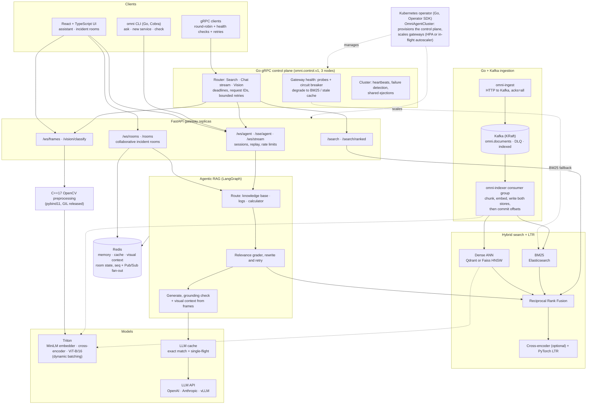

<div align="center">

# OmniAgent

**A real-time, multimodal AI copilot for technical-support and incident-response teams.**

Ask questions in plain language, get answers grounded in your runbooks and live logs, show it what's on your screen,
and work the incident together with your team, on infrastructure built to stay up when parts of it fail.


</div>

---

## Contents

1. [What is OmniAgent?](#what-is-omniagent)
2. [The problem](#the-problem)
3. [How OmniAgent solves it](#how-omniagent-solves-it)
4. [Results](#results)
5. [Architecture](#architecture)
6. [Tech stack](#tech-stack)
7. [Getting started](#getting-started)
8. [Using OmniAgent](#using-omniagent)
9. [Components in depth](#components-in-depth)
10. [Deployment](#deployment)
11. [Observability](#observability)
12. [Testing and quality gates](#testing-and-quality-gates)
13. [Benchmarks: how to reproduce](#benchmarks-how-to-reproduce)
14. [Configuration](#configuration)
15. [Repository layout](#repository-layout)
16. [Known limitations](#known-limitations)

---

## What is OmniAgent?

OmniAgent is an agentic copilot for the people who keep systems running: support engineers, SREs and on-call
responders. You ask it something like *"storage-07 keeps throwing EIO-5, what's going on?"* and it:

- **finds** the relevant runbook sections with hybrid (keyword + semantic) search and a learned ranker,
- **reasons** about them with an agent that checks its own evidence, rewrites weak searches and refuses to answer
  when the knowledge base doesn't support an answer,
- **looks** at live logs and at a camera or screen frame you share,
- **streams** a cited answer token by token, and
- **shares** the whole investigation in an incident room where your teammates see the same timeline, evidence and
  answers in real time.

Underneath is a production-style platform: a streaming gateway, a Kafka ingestion pipeline, GPU-ready model serving,
a fault-tolerant gRPC control plane and a Kubernetes operator. All of it is tested, and the claims in this README are
backed by benchmark runs whose raw outputs are in [`benchmarks/results/`](benchmarks/results/).

## The problem

Incident response is slow for reasons that have little to do with how smart the responders are:

| Pain point | What it costs |
| --- | --- |
| **Knowledge is scattered.** Runbooks, past tickets, logs and dashboards live in different tools. | Minutes spent searching before anyone starts fixing. |
| **Keyword search misses; semantic search hallucinates relevance.** Error codes need exact matches, symptoms need meaning. | The right runbook exists but isn't found. |
| **Generic chatbots answer confidently without evidence.** | Wrong fixes applied under pressure. |
| **Context is visual.** The clue is often on a screen, a dashboard or a blinking rack. | Responders describe screenshots in chat instead of sharing them. |
| **Incidents are team sport.** Several people investigate the same outage in parallel. | Duplicate work, lost findings, no shared picture. |
| **The tooling itself must not fall over during an incident.** | The copilot fails exactly when it is needed most. |

## How OmniAgent solves it

| Capability | What it does | Built with |
| --- | --- | --- |
| **Hybrid search + learning-to-rank** | BM25 and dense vector search run in parallel, are fused with Reciprocal Rank Fusion, then re-ordered by a learned ranker over 15 query-relative features. | Elasticsearch, Qdrant / Faiss HNSW, PyTorch, MiniLM |
| **Self-correcting agent** | Routes each question to the knowledge base, live logs, a calculator or a direct reply; grades retrieved passages, rewrites weak queries, checks the answer is grounded, and abstains with citations when evidence is missing. | LangGraph, Claude / OpenAI-compatible LLMs, offline heuristic fallback |
| **Real-time streaming** | WebSocket and SSE sessions with heartbeats, replay, rate limits and integrity checks (per-frame sequence numbers, token SHA-256). | FastAPI, asyncio, Redis |
| **Multimodal context** | Camera or screen frames are preprocessed in C++ and classified by a vision transformer; the labels become context for the agent's next answer. | C++17 + OpenCV (pybind11), ViT-B/16 on NVIDIA Triton with dynamic batching |
| **Fast, cheap repeat answers** | An exact-match LLM cache with single-flight coalescing serves repeated questions without new model calls. | Redis |
| **Scalable, loss-free ingestion** | Uploads go to Kafka; a consumer group chunks, embeds and indexes into both stores, committing offsets only after both writes succeed. Replays never duplicate. | Go, Kafka (KRaft), franz-go |
| **Fault-tolerant control plane** | A multi-node gRPC tier routes Search, Chat and Vision to healthy gateways with deadlines, retries and circuit breaking, and degrades to keyword-only search instead of failing. | Go, gRPC, Protocol Buffers |
| **Self-managing deployment** | A Kubernetes operator provisions the control plane, repairs drift and autoscales the gateways from live load. | Go, Operator SDK, controller-runtime |
| **Collaborative incident rooms** | Shared rooms with presence, typing indicators, a gap-free event timeline, pinned evidence and streamed agent answers, synchronized across every server replica. | Redis Pub/Sub + Lua, WebSockets, React + TypeScript |
| **Developer tooling** | A CLI that asks the agent, ingests runbooks, scaffolds hardened services and runs security checks. | Go, Cobra |

## Results

Measured on modest hardware: a 4-vCPU / 16 GB GitHub Codespace (CPU only, single-node `kind` cluster) or an Apple M2
laptop. Every number links to a raw result file.

| Area | Result | Measured on |
| --- | --- | --- |
| **Search relevance** | **nDCG@10 0.408**, **+22.0%** over the RRF hybrid baseline and +13.0% over dense-only (p < 0.001), on BEIR CQADupStack: 457,199 documents, 2,581 held-out test queries. | [`retrieval/`](benchmarks/results/2026-11-20/retrieval/) |
| **Search latency** | Hybrid `/search` **p50 28.7 ms** single-client over 807k chunks; LTR-ranked p50 42.9 ms. | [`latency/`](benchmarks/results/2026-11-20/latency/) |
| **Agent throughput** | **3.6× more agent turns/s** (1.93 → 7.04) and **88% fewer LLM tokens** on repeated questions with the LLM cache. | [`agent/`](benchmarks/results/2026-11-20/agent/) |
| **Developer CLI** | `omni new service --verify` generates, tests and security-checks a hardened Go service in **2.0–2.6 s** with 0 findings. | local runs, Go 1.27.4 |
| **Multimodal** | C++ preprocessing **1.24–1.35× faster** than Python OpenCV (single thread, outputs within 3.6e-7); end-to-end frame → answer context verified on Kubernetes. | [`multimodal/`](benchmarks/results/2026-11-20/multimodal/) |
| **Ingestion durability** | **0 documents lost, 0 duplicated** (3,000 docs / 4,692 chunks) through four rounds of `SIGKILL`-ing all indexers and the Kafka broker mid-stream. | [`kafka-ingestion/`](benchmarks/results/2026-11-21/kafka-ingestion/) |
| **Control-plane failover** | **0 failed requests** out of 72,098 (local, 3 node kills) and 11,390 (Kubernetes, 3 node kills); peers detect a dead node in **1.21 s** (median); **+2.0 ms** p50 routing overhead on Kubernetes. | [`grpc-control-plane/`](benchmarks/results/2026-11-21/grpc-control-plane/) |
| **Graceful degradation** | With the model server taken down for 60 s: **0 errors in 162,424 calls**; search switched to keyword-only answers within **190 ms** and recovered automatically. | [`grpc-control-plane/kind/`](benchmarks/results/2026-11-21/grpc-control-plane/kind/) |
| **Operator** | Provisions the control plane in **1.06 s** (median), repairs a deleted deployment in **0.20 s**, and decides to scale up **4× faster** than a CPU-based HPA (11 s vs 43 s). | [`phase4b-operator-remeasure/`](benchmarks/results/2026-11-21/phase4b-operator-remeasure/) |
| **Collaborative rooms** | **1,200 concurrent sessions** in 60 rooms, ~11,500 deliveries/s: state sync **p50 1.4 ms, p95 3.8 ms** (median of 6 runs); **0 gaps, 0 duplicates, 0 reorders** across 511k messages. | [`collaborative-rooms/`](benchmarks/results/2026-11-21/collaborative-rooms/) |

**What the numbers do not show (yet):** these runs are CPU-only. On this hardware the ViT model takes ~220 ms per
frame and Triton's dynamic batching adds only 4–7% throughput; full-pipeline ingestion is bound by CPU embeddings
(13 docs/s); and the collaborative rooms' p99 varies from 5 ms to 2 s between runs on a shared laptop. A GPU and
dedicated load generators are the next step; see [Known limitations](#known-limitations).

## Architecture



### How a question flows through the system

1. **A user asks** in the UI, the CLI, an incident room, or through the gRPC control plane.
2. **The control plane** (when used) picks a healthy gateway, propagates the caller's deadline and a request ID, and
   retries on another gateway if one fails.
3. **The agent** rewrites follow-ups into standalone questions, adds any shared camera context, and routes the
   question to a tool.
4. **Search** runs BM25 and dense retrieval in parallel, fuses them, and re-ranks with the learned model.
5. **The agent grades** the passages (rewriting and retrying if they're weak), generates an answer through the LLM
   cache, and verifies every claim against the sources.
6. **The answer streams** back with sequence numbers and a checksum; in a room, every participant receives it.

## Tech stack

| Layer | Technologies |
| --- | --- |
| **Gateway and agent** | Python 3.12, FastAPI, asyncio, LangGraph, Pydantic, OpenTelemetry |
| **Search and ranking** | Elasticsearch (BM25), Qdrant, Faiss HNSW, PyTorch learning-to-rank, sentence-transformers MiniLM |
| **Model serving** | NVIDIA Triton (ONNX Runtime backend), ONNX, torchvision ViT-B/16, dynamic batching |
| **Native code** | C++17, OpenCV, pybind11 |
| **Backend services (Go)** | Go 1.27, gRPC + Protocol Buffers, franz-go (Kafka), Cobra, controller-runtime / Operator SDK |
| **Data and messaging** | Apache Kafka (KRaft), Redis (cache, memory, Pub/Sub, Lua) |
| **Frontend** | React 19, TypeScript (strict), Vite, Tailwind CSS v4, Vitest, Playwright |
| **Platform** | Kubernetes, Helm, kind, Docker (distroless, non-root images), Prometheus, Grafana |

## Getting started

### Prerequisites

| Tool | Needed for |
| --- | --- |
| Python 3.12 and [`uv`](https://github.com/astral-sh/uv) (or pip) | Gateway, agent, tests |
| Node 22 | Frontend |
| Go 1.27 | CLI, ingestion, control plane, operator |
| Docker + `kind` + Helm *(optional)* | Full Kubernetes stack. A ready-made Codespace config is in `.devcontainer/kind/`. |

No external services are required for local development: every backing service has an in-process fallback (see
[Configuration](#configuration)).

### Run it locally in two minutes

```bash
make install     # Python venv + deps, frontend deps, Playwright Chromium
make demo        # boot the whole stack and drive 24 concurrent agent users
make demo-ui     # same, plus the web UI; keeps running until Ctrl-C
```

Or step by step:

```bash
uv venv --python 3.12 .venv && source .venv/bin/activate
uv pip install -r requirements-dev.txt
cp .env.example .env

uvicorn backend.main:server_app --factory --reload \
  --http backend.uvicorn_protocol:PacedHttpToolsProtocol      # gateway on :8000
cd frontend && npm install && npm run dev                      # UI on :5173 (proxies to :8000)
```

The default configuration runs fully offline: a heuristic reasoner instead of an LLM, a hashing embedder and a mock
model server. Set `LLM_PROVIDER=anthropic` (or `openai`) and an API key in `.env` for generated answers.

### Run the full stack on Kubernetes

The `kind` Codespace builds every image (gateway, UI, Triton with the models baked in, Go ingestion, control plane,
operator) and deploys the Helm chart on a single-node cluster:

```bash
gh codespace create -R <owner>/Omni-agent -b main \
  --devcontainer-path .devcontainer/kind/devcontainer.json -m standardLinux32gb
# inside the Codespace:
TRITON_TAG=26.10-py3 deploy/kind/up.sh       # export models, build images, create cluster, helm install
```

## Using OmniAgent

### Web UI

- **Assistant tab:** chat with the agent. A live inspector shows the routing decision, retrieval scores, query
  rewrites, grounding checks, time to first token and the trace ID.
- **Incident rooms tab:** create a room or join one by ID (`#room=<id>` links are shareable). See who's here and what
  they're looking at, chat, pin evidence, ask the agent for everyone, and share camera context.

### CLI

```bash
make cli                                        # builds cli/bin/omni
omni connect --server http://127.0.0.1:8000
omni sources add ./runbooks                     # ingest Markdown runbooks
omni ask "What does EIO-5 mean on storage-07?"
omni ask --continue "Which firmware fixes it?"  # follow-up on the same thread
omni new service ticket-router --lang go        # scaffold a hardened, tested service
omni check                                      # secrets, Dockerfile, Kubernetes and dependency checks
```

See [`cli/README.md`](cli/README.md) for every command.

### HTTP and WebSocket API

```bash
curl -X POST localhost:8000/ingest -H 'content-type: application/json' \
  -d '{"documents":[{"doc_id":"kb1","title":"KB","text":"# KB\n## Disk\nEIO-5 means ..."}]}'
curl -X POST localhost:8000/search -H 'content-type: application/json' \
  -d '{"query":"EIO-5 controller timeout","top_k":5}'
curl -N 'localhost:8000/sse/agent?q=What+does+EIO-5+mean'      # streamed agent turn
curl -X POST localhost:8000/rooms -H 'content-type: application/json' -d '{"title":"storage-07 EIO"}'
```

| Endpoint | Purpose |
| --- | --- |
| `GET /health`, `/livez`, `/readyz`, `/metrics` | Health, Kubernetes probes, Prometheus metrics |
| `POST /ingest`, `POST /search`, `POST /search/ranked` | Ingest documents; hybrid search; learned-ranker search with per-stage timings |
| `WS /ws/agent`, `GET /sse/agent` | Agent turns with memory (`thread_id`), streamed |
| `WS /ws/stream`, `GET /sse/stream` | Low-level streaming search (and audio frames) |
| `WS /ws/frames`, `POST /vision/classify` | Camera/screen frames → labels → the thread's visual context |
| `POST /rooms`, `GET /rooms/{id}`, `GET /rooms/{id}/events`, `WS /ws/rooms/{id}` | Collaborative incident rooms |
| gRPC `omni.control.v1.Router` / `Cluster` | Control-plane Search, Chat, Vision; node membership |

## Components in depth

<details>
<summary><b>Hybrid search and learning-to-rank</b></summary>

- **Ingestion** splits documents on Markdown headings (recording the heading path), packs paragraphs up to
  `CHUNK_SIZE` characters with `CHUNK_OVERLAP` overlap, and gives each chunk a deterministic UUIDv5, so re-ingesting a
  document overwrites its chunks. Embedding + dense upsert and BM25 indexing run concurrently.
- **Retrieval** runs dense ANN and BM25 in parallel and fuses them with RRF: `score(d) = Σ 1 / (60 + rank_r(d))`.
  Every hit reports its rank in each list, so you can see which retriever found it.
- **Ranking**: an optional cross-encoder re-scores the top candidates (with a timeout fallback to RRF order), then a
  PyTorch ListNet model over 15 query-relative features produces the final order. `/search/ranked` reports timings
  per stage.
- **Evaluation**: a BEIR CQADupStack harness (12 forums, 457,199 documents, 807,495 chunks, 13,145 judged queries,
  60/20/20 split) with paired significance tests: `benchmarks/retrieval/`.

| Ranker | nDCG@10 | vs RRF hybrid |
| --- | --- | --- |
| BM25 | 0.2569 | −23.1% |
| Dense (MiniLM) | 0.3609 | +8.0% |
| RRF hybrid (baseline) | 0.3343 | — |
| LTR | 0.4023 | +20.3% |
| **LTR + cross-encoder feature** | **0.4080** | **+22.0%** |

</details>

<details>
<summary><b>Agent (LangGraph)</b></summary>

```
START → contextualize → route ─knowledge_base→ retrieve → grade_documents ─relevant→ generate
                          │                       ↑               │
                          │                 rewrite_query ←───────┘ not relevant (retries left)
                          ├─live_logs→ inspect_logs → generate
                          ├─calculator→ calculate ───→ generate
                          └─direct──────────────────→ generate
generate → grade_generation ─grounded→ finalize → END
                 └─not grounded (retries left)→ rewrite_query
```

- **contextualize** turns follow-ups into standalone questions and attaches any shared camera context.
- **route** picks the knowledge base, live logs, a calculator (AST-whitelisted, never executes code) or a direct reply.
- **grade_documents** and **grade_generation** reject weak evidence and ungrounded answers; the agent rewrites the
  query and retries (shared `AGENT_MAX_RETRIES`, default 2), then abstains with citations if it still can't answer.
- **Reasoners**: Claude (`LLM_PROVIDER=anthropic`), any OpenAI-compatible endpoint including vLLM, or the offline
  heuristic default. A failed LLM step falls back to the heuristic for that step only.
- **Memory**: conversations are LangGraph threads checkpointed in Redis with a custom saver that uses only core Redis
  types and passes LangGraph's 58-test checkpointer conformance suite.
- **LLM cache**: exact-match responses at temperature 0, with single-flight coalescing of identical in-flight calls.

</details>

<details>
<summary><b>Streaming gateway</b></summary>

Each WebSocket session runs a reader (validation, per-session token bucket, ring buffer), a worker (in-order
processing) and a heartbeat task. Every server frame carries a strictly increasing `seq`; answers end with a token
count and SHA-256 so clients can verify the stream. Close codes: `1009` too big, `1013` at capacity, `4408` heartbeat
timeout. SSE endpoints carry the same event sequence and honour W3C `traceparent`.

</details>

<details>
<summary><b>Multimodal frames</b></summary>

- **Preprocessing** (`native/vision/`): a C++17 pybind11 extension decodes JPEG/PNG, resizes the short side to 256,
  center-crops 224 and normalizes to NCHW float32 in one fused pass, with the GIL released and a zero-copy result.
- **Inference**: torchvision ViT-B/16 exported to ONNX (dynamic batch axis) and served by Triton with dynamic batching
  (`vit_b16`) or without it (`vit_b16_nobatch`) for comparison.
- **Context**: labels from `/ws/frames` or `/vision/classify` are stored per conversation thread (or room) in Redis and
  given to the agent's next turn.

</details>

<details>
<summary><b>Go + Kafka ingestion pipeline</b></summary>

- **`omni-ingest`** accepts JSON or NDJSON uploads, keys each record by `tenant/doc_id` (so every version of a
  document lands on the same partition) and returns `202` only after Kafka has acknowledged every record (`acks=all`,
  idempotent producer).
- **`omni-indexer`** workers form a consumer group. Each poll is chunked, embedded through Triton and written to
  Elasticsearch and Qdrant; offsets are committed **only after both writes**. Outages are retried with backoff and
  never committed past; permanently bad records go to a dead-letter topic.
- **Idempotency**: chunk IDs are UUIDv5 of `doc_id:position`, used as the record ID in both stores. The Go chunker and
  WordPiece tokenizer are ports of the Python ones, pinned by golden fixtures (2,355 chunks, 33 tokenizer texts) so
  both pipelines produce identical IDs and embeddings.
- **Verification**: `omni-ingest-bench` checks every document's chunk count in both stores and the DLQ after each run.

</details>

<details>
<summary><b>gRPC control plane</b></summary>

- **Contract**: `controlplane/proto/omni/control/v1/control.proto`. `Router` (Search, streaming Chat, Vision) and
  `Cluster` (Register, Heartbeat, GetClusterState).
- **Routing**: the caller's deadline bounds every upstream attempt; requests carry `X-Request-ID`; at most 3 attempts,
  each on a different gateway; the less loaded of two random healthy gateways is chosen.
- **Health**: active `/readyz` probes plus passive failure counting; a circuit breaker ejects failing gateways with
  growing cooldowns and only a passing probe re-admits them. Ejections spread to peers within one heartbeat.
- **Degradation**: Search falls back to BM25 straight from Elasticsearch, then to the last good answer, before
  returning `UNAVAILABLE`; Chat restarts on another gateway if one dies mid-answer, or returns the best passages.
- **Clients** use round-robin with gRPC health checking and retries, so a dead or draining node is skipped transparently.

</details>

<details>
<summary><b>Kubernetes operator</b></summary>

The `OmniAgentCluster` custom resource (`operator/`, Operator SDK) provisions the control plane (Deployment, headless
Services, PodDisruptionBudget, NetworkPolicy), restores anything that drifts or is deleted, and scales the gateway
Deployment either with a CPU HorizontalPodAutoscaler (`mode: hpa`) or with its own autoscaler driven by the control
plane's live in-flight load (`mode: operator`). Controller logic is tested against a real kube-apiserver with envtest.

</details>

<details>
<summary><b>Collaborative incident rooms</b></summary>

- **Ordering**: one Redis Lua script assigns each event a room sequence number, stores it and publishes it atomically,
  so every replica delivers events in the same order.
- **Fan-out**: each gateway replica holds one Pub/Sub subscription for its rooms and forwards raw events to bounded
  per-session queues. A slow client is disconnected with a resync code instead of stalling the room.
- **Catch-up**: clients reconnect with `last_seq` and receive exactly the missed events. Messages carry a
  `client_msg_id`, so a resend after a reconnect is delivered once.
- **Shared AI**: agent answers stream to every participant; a frame shared by anyone becomes the room's visual context.

</details>

<details>
<summary><b>Frontend</b></summary>

A single-page React 19 app on its own origin (works behind any proxy). The transport layer reconnects with backoff,
answers heartbeats, verifies sequence numbers and answer checksums, and for rooms resumes from `last_seq` and resends
unacknowledged messages. Tested with Vitest (client, reducers, components) and Playwright (end to end against a real
backend).

</details>

## Deployment

The Helm chart lives in [`deploy/kubernetes/helm/omniagent`](deploy/kubernetes/helm/omniagent); rendered manifests are
in `deploy/kubernetes/manifests/` (`make manifests`).

| Component | Kubernetes resources | Notes |
| --- | --- | --- |
| Gateway | Deployment, Service, HPA, PDB | probes, graceful drain, rolling updates with `maxUnavailable: 0` |
| UI | Deployment, Service | unprivileged nginx; proxies `/ws`, `/sse`, `/rooms` |
| Qdrant, Elasticsearch, Redis | StatefulSets + PVCs | each swappable for a managed service (`<store>.externalUrl`) |
| Triton | Deployment | models baked into the image or mounted from a PVC; GPU toggle |
| Kafka + ingestion | StatefulSet (KRaft) + Deployments | `kafka.enabled`, `ingestion.enabled` |
| Control plane | Deployment, headless Services, PDB | `controlPlane.enabled`, or managed by the operator |
| Operator | CRD, RBAC, manager Deployment | `deploy/kubernetes/manifests/operator.yaml` |
| Ingress | Ingress | exposes only `/ws`, `/sse`, `/rooms`, `/health` and the UI |
| Security | NetworkPolicies per port | every datastore admits only the pods that need it |

Every workload runs as non-root with a read-only root filesystem and all capabilities dropped (Elasticsearch's root
filesystem is the one documented exception). The chart refuses to render inconsistent settings, and
`tests/test_helm_chart.py` checks the invariants on every change.

```bash
helm install omniagent deploy/kubernetes/helm/omniagent -n omniagent --create-namespace \
  --set ingress.host=omniagent.example.com \
  --set config.llmProvider=anthropic --set secrets.values.ANTHROPIC_API_KEY=$ANTHROPIC_API_KEY
```

## Observability

| Signal | Where |
| --- | --- |
| **Metrics** | `/metrics` on the gateway, ingestion services and control plane: sessions, tokens, agent outcomes, retries, cache hits, Triton latency, frame timings, room events, failovers, degraded responses. A Grafana dashboard ships with the chart. |
| **Traces** | OpenTelemetry spans across WebSocket sessions, agent turns and Triton gRPC calls; export with `OTEL_EXPORTER_OTLP_ENDPOINT`. |
| **Logs** | JSON lines with `trace_id` and `span_id` (`LOG_FORMAT=json`). |
| **Health** | `/health` reports every backend, inference readiness, session counts and event-loop lag percentiles. |

## Testing and quality gates

| Gate | What runs |
| --- | --- |
| Python | ~255 pytest tests: API, agent, search, ingestion, vision, rooms (including two replicas sharing a real Redis), Helm chart invariants |
| Go | Unit and integration tests for the CLI, ingestion, control plane (including a 3-node failover test run under the race detector) and operator (envtest against kube-apiserver 1.37) |
| Frontend | Strict TypeScript build, Vitest unit and component tests, Playwright end-to-end tests |
| Security | `omni check`: secrets, Dockerfile and Kubernetes hardening rules, `govulncheck`, `pip-audit`, `ruff`, `gofmt` / `go vet` |

```bash
make verify      # everything CI would run
make security    # omni check on this repository
```

## Benchmarks: how to reproduce

| Benchmark | Command |
| --- | --- |
| Retrieval quality (BEIR) | `python -m benchmarks.retrieval.run {embed,index,collect,score-ce,evaluate} --work <dir>` |
| Search latency | `python -m benchmarks.retrieval.run latency --server http://127.0.0.1:8000 --work <dir>` |
| Agent throughput + LLM cache | `python -m benchmarks.agent_throughput` |
| C++ vs Python preprocessing | `python -m benchmarks.vision_preprocess` |
| Triton dynamic batching on/off | `deploy/kind/bench-multimodal.sh <out_dir>` |
| Kafka ingestion + crash/replay | `deploy/kind/kafka-bench.sh`, `deploy/kind/kafka-crash-replay.sh` |
| Control-plane failover | `scripts/controlplane_harness.sh` (local) or `deploy/kind/grpc-control-plane-bench.sh` |
| Operator provisioning + autoscaling | `deploy/kind/phase4-up.sh && deploy/kind/operator-bench.sh <out_dir>` |
| Collaborative rooms | `scripts/collab_rooms_bench.sh <out_dir>` |

Raw outputs, logs and summaries are under [`benchmarks/results/`](benchmarks/results/), organized by date and area.

## Configuration

Settings come from environment variables (see `.env.example`). Each backing service switches on when its URL is set;
otherwise an in-process fallback runs, so nothing external is needed for development.

| Service | Environment variable | Fallback when unset |
| --- | --- | --- |
| Qdrant | `QDRANT_URL` | embedded in-memory Qdrant |
| Elasticsearch | `ELASTICSEARCH_URL` | pure-Python Okapi BM25 |
| Redis | `REDIS_URL` | in-process cache, rate limiter, memory and rooms |
| Triton | `INFERENCE_BACKEND=triton`, `TRITON_GRPC_URL` | in-process mock inference |
| LLM | `LLM_PROVIDER`, `ANTHROPIC_API_KEY` / `LLM_API_KEY` | offline heuristic reasoner |
| Vision | `VISION_BACKEND=triton` | off |
| Tracing | `OTEL_EXPORTER_OTLP_ENDPOINT` | spans created, not exported |

## Repository layout

```
backend/          FastAPI gateway
  agent/            LangGraph workflow, reasoners, memory, tools, LLM clients + cache
  api/              WebSocket/SSE sessions, agent, frames and rooms endpoints
  rooms/            Redis room store (atomic seq + Pub/Sub) and per-replica fan-out hub
  vision/           frame preprocessing and visual context
  core/             config, stores, cache, rate limiting, metrics, telemetry
  ingestion/        chunker, embedders, async ingestion pipeline
search/           hybrid retrieval, RRF, reranking pipeline
model_server/     Triton model repository, ONNX export, async gRPC client, local Triton-protocol server
native/vision/    C++17 pybind11 OpenCV preprocessing extension
ingestion/        Go: omni-ingest, omni-indexer, omni-ingest-bench
controlplane/     Go gRPC control plane (omni.control.v1), failover client, load generator
operator/         Go Kubernetes operator (Operator SDK): OmniAgentCluster CRD and controller
cli/              Go `omni` CLI (Cobra)
frontend/         React 19 + TypeScript UI
deploy/           Dockerfiles, Helm chart, rendered manifests, kind scripts
benchmarks/       benchmark harnesses and results/
scripts/          demos and benchmark drivers
tests/            Python test suite
samples/          small technical-support corpus and logs used by tests and demos
```

## Known limitations

- **CPU-only measurements.** No GPU was available: ViT inference (~220 ms per frame), Triton dynamic batching
  (+4–7% on CPU) and full-pipeline ingestion (13 docs/s, bound by CPU embeddings) all need a GPU to show their real
  ceiling.
- **Single-node clusters.** Kubernetes results come from a single-node `kind` cluster, and Kafka runs as one KRaft
  broker (durability rests on its volume; replication factor 1).
- **Tail latency on shared hardware.** Collaborative-room p99 varies widely between runs when the server and the load
  generator share one laptop; p50 and p95 are stable.
- **Operator autoscaling.** The in-flight autoscaler can shed a replica mid-spike once added capacity brings in-flight
  work down; a rate-based target is the planned fix.
- **No authentication yet.** Anyone with a conversation thread ID or room ID can join it.
- **LLM-backed answers** were benchmarked with OpenAI; the Claude and vLLM paths are tested with fakes.
- **Live logs** read `.log` files; a Loki or Elasticsearch log backend is still to be added.
- **Ingestion updates** that shrink a document leave its old higher-position chunks behind (both pipelines); a
  delete-by-document step is planned.

---

<div align="center">

**License:** not yet chosen. All rights reserved until a license file is added.

</div>
